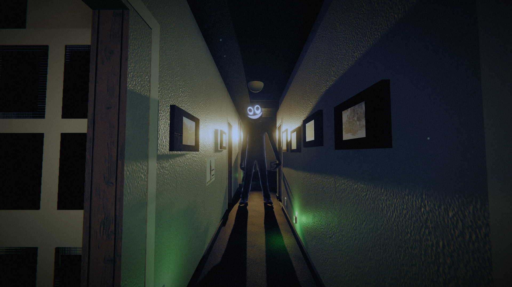

# TOP BUNK



A short first-person horror game made with [three.js](https://threejs.org). Your family has just moved into a cheap rented farmhouse, you've got the top bunk, and something tall lives at the end of the hall. It runs in the browser straight from GitHub Pages, with no build step, and as a desktop build for Steam ([STEAM.md](STEAM.md)).

## Story

Moving day: carry your three boxes from the truck to your room, the back-left corner room at the end of the hall, next to the bathroom. Someone left a crayon drawing taped up in the hall, and someone measured a boy called Ben on the side of your closet until he was seven. By the time you bring in your last box there is a fourth one in your room with your name on it in a little kid's crayon. At bedtime Dad comes to your door, says goodnight and pulls it almost shut; you close your eyes and dream an old black-and-white cartoon, a bedtime safety picture hosted by your own bear, Mister Buttons, who shows you how to hold your breath under the covers and waits until you do it yourself. By the end something has come for him too. At 2:47 that night the house goes quiet and the hall light Mom promised to leave on clicks off. Nothing tells you where to go: what happens depends on where you are. Stay in the bunk and something lies down in the bottom bunk under you, then walks up the hall and stops at your door; get up and your door shuts behind you, it calls you in Mom's voice from behind her door while she snores, it draws itself into the drawing, it pulls out the kitchen chairs, or it knocks inside the wall beside you. When you have heard enough of it, it comes to wherever you are: to your bed, where you hold your breath under the covers while it leans over you, or into the room you're in, where you can cover your face or watch it bend down to yours. Then the hall light comes on and Mom finds you. In the morning you walk down to the table, sit, and tell them; nobody believes you.

From night two the whole house is open, a clock runs toward dawn, and the thing in the hall hunts you. You run, shut doors, hide and hold your breath. Every room has a light switch by its door (two in the hall): a lit room makes you easier to find, but the thing won't walk into the light while you're looking at it. It waits just past where the light stops, and the bulb doesn't last long with it standing there. The house works the switches too: a room you lit goes dark behind you, a dark one lights up ahead of you, and bulbs flicker and die when it comes near. The run's seed decides what each night is about (the phone, the TV, Mom calling from the kitchen while she's asleep, the blackout, the drive, the vigil and others), and most nights leave something behind: a sound gives it away, and you photograph it with your disposable camera to lay on the breakfast table in the morning (Tab, or Select on a controller, shows your photos). Get caught and you play the night again. On night ten it comes down the hall, and how many photos you showed them decides which of the three endings you get.

## Controls

| Action | Keyboard + mouse | Game controller (Xbox · PlayStation) | Touch |
|---|---|---|---|
| Move / Look | WASD or arrows / mouse | Left stick / right stick | Drag on the left half (floating stick) / drag on the right half |
| Sprint (limited stamina; hold) | Shift | RT · R2 (or L3) | RUN |
| Interact, use what you hold; the shutter when the camera is up | E or left click | A · ✕ (or X · □) | USE (a shutter while the camera is up) |
| Camera up / down | C (toggle), right click (hold or toggle, in Options) | Y · △ (or d-pad down) | CAM |
| Flashlight | F | RB · R1 (or d-pad up) | LIGHT |
| Hold your breath while hiding / pull the covers over your head in the bunk (hold; tap once to keep holding) | Space | LT · L2 (or LB · L1) | HOLD BREATH / COVER UP |
| Put the camera away | C or right click again | B · ○ | — |
| Your journal and photos (toggle; Tab opens on the photos) | J, Tab | View · Create | The notebook at the top |
| Pause | Esc | Start · Options | II |
| Skip the bedtime cartoon (hold) | Esc | Start · Options | SKIP |
| Menus: choose / change / select / back / tabs / resume | Arrows or WASD / ← → / Enter or Space / Esc or Backspace / Q, E / — | D-pad or stick / ← → / A / B / LB, RB / Start | Tap / ‹ › / tap / ✕ / swipe / II |

Prompts, the Controls panel and the bedtime cartoon follow whichever input you used last and show your pad's own buttons (Xbox, PlayStation or Switch names). The menus work from the keyboard or a controller. Controllers rumble on the scares. On phones the game goes fullscreen in landscape and starts on the Medium graphics preset. Headphones recommended.

Options (title and pause menus) has volume, look sensitivity, invert Y, field of view, head bob, graphics, subtitles, a reduce-flashing switch and the bedtime cartoon (on or off; hold Esc, Start or SKIP to skip it once you have passed its lesson, or straight away after the first time).

## Run locally

ES modules need a web server (opening `index.html` from disk won't work):

```bash
python3 -m http.server 8000
# open http://localhost:8000
```

`npm test` runs `tests/smoke.js`: the game in headless Chromium through the title, a day, a night and a phone-sized touch screen. It needs Playwright's Chromium (`npm install`, then `npx playwright install chromium`). `node tests/contacts.js` poses Mom, Dad and grandpa the way the game does (at the table, the stove, the mug, a carried box, the camera, asleep, the vigil chair) and reports any body part more than 1.5 cm inside the furniture or what they hold; `--shots dir` saves a picture of each pose.

## Deploy to GitHub Pages

Settings → Pages → Source: **GitHub Actions**. `.github/workflows/static.yml` then deploys every push to `main`. The site will be at `https://<user>.github.io/<repo>/`.

## Project layout

| Path | What it is |
|---|---|
| `index.html` | HUD, title/pause/death/end screens, import map for the vendored three.js r170 (`vendor/three`) |
| `css/` | HUD and screen styling, film grain, vignette, blanket overlay; `fonts.css` loads the fonts in `assets/fonts/` |
| `js/main.js` | Game loop, player, collisions, moving day, the mornings, night ten's endings |
| `js/nights.js` | The nights: clock, hiding places, proof and the camera, and what each kind of night does |
| `js/director.js` | Which night is which for a seed, and the small events that fill a night |
| `js/hunter.js`, `js/nav.js` | How the thing shows itself, stalks, hunts and searches, and the graph of the house it walks on |
| `js/entity.js`, `js/creature.js`, `js/mathx.js` | The thing itself: model, animation, head and eye tracking; its face, built in code; small shared math helpers |
| `js/world.js` | The early-2000s farmhouse (brown carpet, white kitchen, hall, your back-left room), furniture, yard, garage, truck, barn, lights, the road out front and the street light at the end of the drive |
| `js/weather.js`, `js/traffic.js` | Rain, wet ground and lightning on the nights the seed makes wet; the cars that pass on the road, and the one the car-pass scare sends by |
| `js/people.js`, `js/rig.js` | Mom and Dad, and the skeleton and clips their models share |
| `js/cartoon.js` | The bedtime cartoon: Mister Buttons in "Hush-a-Bye!", an early-1930s black-and-white safety short drawn on a 2D canvas (a grey rubber-hose teddy with white gloves and black boots in boiling hand-inked lines, his own squeaky voice, a painted bunk-bed set and, under the covers, a huge gingham tent; hand-lettered cards; a worn-out nitrate print with a crackly optical soundtrack); it teaches holding your breath under the covers, waits for you to do it, says "The End" and keeps running |
| `js/vigil.js`, `js/nightmares.js`, `js/swim.js`, `js/cars.js`, `js/windowface.js` | The vigil night; the four nightmares and the dream swim they share with it; the car for the dream drive and the drive away; headlights and the face at the window |
| `js/lights.js` | The ceiling lights and their switches, and what the house does with them |
| `js/gfx.js`, `js/pbr.js`, `js/props.js`, `js/textures.js`, `js/dust.js` | Post-processing and quality presets, PBR materials, furniture models, canvas textures (the crayon drawing, the grin, the floral fabric), dust in the air |
| `js/audio.js` | Synthesized sound, with the recorded files layered on top |
| `js/input.js`, `js/menu.js`, `js/settings.js`, `js/ui.js` | Controller and touch input, the menus, saved options, HUD helpers |
| `js/achievements.js`, `js/rng.js` | Achievements; seeded random numbers |
| `desktop/` | The Electron shell for the desktop build |
| `steam/`, `store/`, `trailer/` | SteamPipe upload config, store page art and copy, the trailer renderer (each has a README) |
| `tools/` | The scripts that made the files in `assets/` (`cd tools && npm install` first for the model slimming) |

## Dev shortcuts

Add a hash to the URL to jump ahead:

| Hash | Goes to |
|---|---|
| `#night`, `#night5` | Night one, or any night from 1 to 10 |
| `#bedtime` | Dad's goodnight, falling asleep and the bedtime cartoon, then night one |
| `#breakfast` | The first morning |
| `#morning` | The drive away after the best ending |
| `#seed=ABCD-1234&night=5` | That run's seed, from that night |
| `#type=vigil` | Forces the kind of night (the names are `TYPES` in `js/director.js`) |
| `#proof=7` | Counts as that much proof found, to reach each ending |

A jump earns no achievements. `#shot` keeps the WebGL drawing buffer so the trailer renderer can capture frames.

## Audio

The files in `assets/` were generated with ElevenLabs and are committed; the game plays them, and the synth covers anything missing.

| What | Where | Made by |
|---|---|---|
| Mom and Dad's lines (text and subtitles in `assets/audio/lines.json`) | `assets/audio/vo/` + `manifest.json` | `tools/gen_voice.py` |
| Music: moving day, night, chase, morning | `assets/music/` + `tracks.json` | `tools/gen_music.py` |
| Night brown-noise bed, jump scares (synth blast, violin screech, slam), the shove, waterphone and music box | `assets/sfx/` + `sfx.json` | `tools/gen_sfx.py` |

To change a line, edit `lines.json` and run `ELEVENLABS_API_KEY=... python3 tools/gen_voice.py --only vo/mom --force` (needs Python 3 and ffmpeg); music and effects work the same way, from the table in their script. The key is read from the environment only, so never put it in a file. The brown noise is made locally with ffmpeg and needs no key.

## Characters

| Who | Model | Animation |
|---|---|---|
| Mom, Dad | [Microsoft Rocketbox](https://github.com/microsoft/Microsoft-Rocketbox) adults (`Female_Adult_01`, `Male_Adult_05`), MIT | Body-language clips for standing, talking, sitting and folded arms (talking follows the loudness of the voice, and each line starts on the other mirror of the clip), hands kept on or above the table when seated, head follows you when you're near, mouth moves with their voice |
| Grandpa | Rocketbox `Male_Adult_03`, without his hair cards, MIT | One seated clip for the vigil chair (`tools/models/sit.js`) |
| The thing | A Rocketbox body (`Male_Adult_06`) in solid black, stretched to about 2.6 m with long arms, with the skull, eyes and smile on its head bone | Run, walk and idle clips, plus code for the lean, head tilt, reaching arms and gaze |

The parents' body language is Quaternius's Universal Animation Library (CC0) and the walk/run/idle clips are Mixamo animations (from the three.js example `Xbot.glb`), both retargeted onto the Rocketbox skeleton; `tools/models/` rebuilds them. Without the model files the game falls back to low-poly people and a low-poly thing. Credits and licences: [CREDITS.md](CREDITS.md).

## Graphics

three.js with a post-processing chain: an HDR sky and image-based lighting, ambient occlusion, bloom, and a film grade (grain, vignette, a dark-adapted look at night). Options → Graphics picks Auto, Ultra, High, Medium or Low. High renders at 1.25x the screen's pixels with 4x MSAA, Ultra at 2x (4K on a 1080p monitor, scaled down). Auto starts on High (Medium on graphics built into the CPU, Low on software rendering, the phone profile on phones), lowers the render resolution when frames get slow and raises it again when there is headroom, steps down a preset only if that is not enough, and steps up to Ultra on a card with plenty of headroom. Options → Graphics settings opens every setting on its own: render scale, anti-aliasing (FXAA, MSAA, supersampling), a frame rate cap (the browser never goes past the display's refresh), shadows, ambient occlusion, bloom, film grain, chromatic aberration, vignette, motion blur, texture filtering, grass density, draw distance, rain, contrast, gamma and a frame rate counter; changing a preset setting makes it Custom. Cinematic cutscenes (on by default on desktop) give the conversations their own look: at least 1.5x render scale, depth of field on whoever speaks, high ambient occlusion, shadow maps at twice the size drawn in around the speaker, a key, fill and rim light on the face, a film curve with a little halation and a 2.39:1 letterbox. People also cast a soft contact shadow on the floor. The ceiling lights (`js/lights.js`) are 60 W bulbs at about 2700 K: the nearest lit fixtures borrow lights from a fixed pool (two that cast soft shadows, three that don't, and a dim bounce that fills the room you're in), so flipping a switch only changes how bright they are and never rebuilds a shader; a strip of light shows under a shut door with a lit room behind it. Add `?perf` to the address to log how long loading and starting a game take.

| Part | Source |
|---|---|
| Surfaces: floors, walls, siding, roof, grass, tile | PBR materials from Poly Haven and ambientCG (CC0), packed by `tools/assets/fetch_pbr.py` into `assets/pbr/` |
| Sky and ambient light | Poly Haven HDRIs (CC0), `tools/assets/fetch_sky.py` into `assets/sky/` |
| Furniture, plants, a tree, rocks, grass | Poly Haven models (CC0), compressed by `tools/assets/fetch_models.py` into `assets/props/` |
| Fixtures, appliances, the bunk, the cars on the road, the mailbox and the cans | Sketchfab models (CC BY 4.0, each listed in `CREDITS.md`), fetched and compressed by `tools/assets/fetch_sketchfab.py` into `assets/props/` |
| Photographs in the frames | Public domain, from Wikimedia Commons, `tools/assets/fetch_photos.py` into `assets/photos/` |
| Kitchen, bathroom, windows, house | Built in code (`js/world.js`) |

If an asset file is missing, the procedural look takes over for that item.
